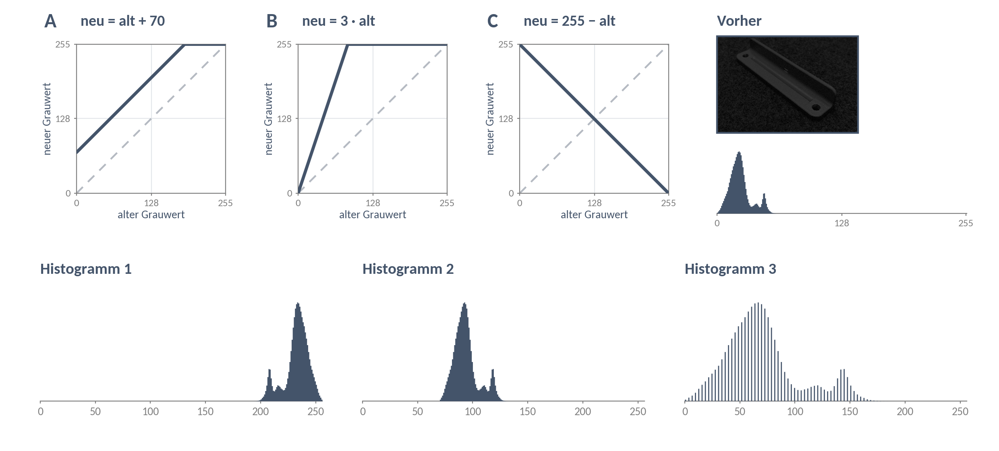

# DS 04 — Arbeitsblatt

**Punktoperationen: Anderes Licht, dieselbe Prüfung · 13.10.2026**

Ein neues Skript im Ordner eurer vier Aufnahmen aus DS 03. Welche Befehle ihr braucht, entscheidet ihr selbst — sie stehen im Werkzeugkasten. Wer festhängt, klappt unter dem Auftrag den nächsten Tipp auf.

---

## P1 — Macht das Bauteil schwarz-weiß (etwa 15 min)

**Ziel:** Ein Bild, in dem das Bauteil weiß ist und der Untergrund schwarz.

**Auftrag:** Erstellt das Histogramm von `misch`, legt einen Schwellwert fest und macht das Bild schwarz-weiß. Wendet dann **dieselbe** Schwelle auf `dunkel` an. Was kommt heraus — und warum?

Achtet darauf, dass ihr von beiden Aufnahmen denselben Bildausschnitt betrachtet: euer Bauteil mit etwas Untergrund ringsum.

**Tipps** — erst selbst probieren, dann immer nur den nächsten aufklappen.

Tipp 1 — Welche Werkzeuge?

Laden, Ausschneiden, Histogramm und Kennwerte, Masken. Alles aus dem Werkzeugkasten, alles schon einmal benutzt.

Tipp 2 — Wo liegt die Schwelle?

Im Histogramm von `misch` gibt es einen großen Berg (der Untergrund) und einen kleinen hellen Berg (das Bauteil). Die Schwelle gehört ins Tal dazwischen. Eure Zahl aus der Hausaufgabe ist ein guter Start.

Tipp 3 — Und dann dunkel

Kopiert die Zeilen und ersetzt `misch` durch `dunkel`. Die Schwelle bleibt dieselbe Zahl. Zeichnet beide Histogramme in ein Diagramm.

Tipp 4 — Woran liegt es?

Sucht im Histogramm von `dunkel` den hellsten Berg. Liegt er links oder rechts von eurer Schwelle?

**Ergebnis:** Unser Schwellwert:

| | `misch` | `dunkel` |
|---|---|---|
| Ausschnitt (Zeilen, Spalten) | | |
| Mittelwert | | |
| Streuung | | |
| Anteil weiß bei unserer Schwelle | % | % |

Woran liegt es? Ein Satz, der sich auf das Histogramm bezieht:

---

## P2 — Weg 1: Passt das Bild an (etwa 17 min)

**Ziel:** Die dunkle Aufnahme nutzt die Helligkeit so wie `misch` — gleicher Mittelwert, gleiche Streuung. Dann sollte eure Schwelle aus P1 wieder greifen.

**Auftrag:** Bearbeitet `dunkel` mit einer Punktoperation *B* = *c* · *A* + *d*. Findet *c* und *d*. Prüft danach, ob eure Schwelle wieder ungefähr dieselbe Maske liefert wie bei `misch`.

**Tipps** — erst selbst probieren, dann immer nur den nächsten aufklappen.

Tipp 1 — Welche Werkzeuge?

„Mit Bildern rechnen" — und für den Vergleich wieder Histogramm, Kennwerte und Maske. Schreibt euch zuerst Mittelwert und Streuung von `misch` auf: Das ist das Ziel.

Tipp 2 — Was macht was?

Probiert eine Rechnung nur mit `+` und eine nur mit `*`. Schreibt jedes Mal Mittelwert und Streuung auf. Welche Rechnung ändert die Streuung, welche nicht?

Tipp 3 — Erst c

Die Streuung ändert nur das Mal. Wie oft passt die Streuung von `dunkel` in die von `misch`? Das ist euer *c*.

Tipp 4 — Dann d

Rechnet erst mal *c*. Was fehlt danach noch am Mittelwert von `misch`? Das ist euer *d* — es kommt mit `+` dazu und ändert die Streuung nicht mehr.

Tipp 5 — Information und Übertreiben

Vergrößert das Histogramm nach eurer Rechnung um den großen Berg herum (`plt.xlim`). Stehen die Säulen dicht an dicht oder mit Lücken? Für das Übertreiben: Verdoppelt euer *c* und zählt die Pixel über 255.

**Ergebnis:**

| Rechnung | Mittelwert | Streuung | Anteil weiß in % | Maske wie bei `misch`? |
|---|---|---|---|---|
| `misch` (das Ziel) | | | | — |
| | | | | |
| | | | | |
| | | | | |

Unsere Rechnung: *B* = … · *A* +

Welcher Teil der Rechnung ändert die Streuung, welcher nur den Mittelwert? Belegt es mit euren Zahlen.

**Untersucht dann zwei Fragen:**

- Ist durch eure Rechnung Information dazugekommen — gibt es jetzt mehr verschiedene Grauwerte als vorher? Belegt es am Histogramm.

- Was passiert, wenn ihr es übertreibt? Wie viel Prozent der Pixel sind dann nicht mehr zu retten, und warum?

---

## P3 — Weg 2: Passt die Schwelle an (etwa 14 min)

**Ziel:** Der Rechner findet die Schwelle selbst — für jede Aufnahme neu.

**Auftrag:** Bestimmt den Schwellwert automatisch mit dem Otsu-Algorithmus, erst für `dunkel`, dann für alle vier Aufnahmen. Vermutet **vorher**, bei welchen Aufnahmen es schiefgeht.

Unsere Vermutung:

**Tipps** — erst selbst probieren, dann immer nur den nächsten aufklappen.

Tipp 1 — Welche Werkzeuge?

Otsu — und „Dasselbe für mehrere Aufnahmen".

Tipp 2 — In der Schleife

In der Schleife muss jede Aufnahme genauso vorbereitet werden wie in P1: laden, Graustufen, **derselbe Ausschnitt**. Erst dann Otsu. Gebt Name, Schwelle und Anteil weiß aus und zeigt die Maske an.

Tipp 3 — Was ist anders?

Zeichnet das Histogramm einer gekippten Aufnahme und markiert in Gedanken die Otsu-Schwelle. Liegt sie in einem Tal zwischen zwei Bergen? Gibt es eine hohe Säule ganz am Rand?

**Ergebnis:**

| Aufnahme | Schwelle | Anteil weiß in % | Maske brauchbar? |
|---|---|---|---|
| `hell` | | | |
| `seitlich` | | | |
| `misch` | | | |
| `dunkel` | | | |

Brauchbar heißt: Das Bauteil ist als eine Fläche zu erkennen, der Untergrund bleibt schwarz. Tragt euer Ergebnis in die Tabelle an der Tafel ein.

Wählt eine Aufnahme, bei der es schiefgeht. Was zeigt ihr Histogramm, das bei `misch` anders ist?

---

## P4 — Prüfungsformat: Kennlinie zuordnen (wer fertig ist)

> Eine dunkle Aufnahme wurde mit drei Punktoperationen bearbeitet. Oben stehen die drei Kennlinien A, B und C, unten die drei Histogramme danach.

a) Der hellere Berg liegt vorher beim Grauwert 48. Wo liegt er nach A, B und C?

   A: … B: … C:

b) Ordnet zu und begründet jeweils mit **einem** Merkmal des Histogramms.

   Histogramm 1 → … weil

   Histogramm 2 → … weil

   Histogramm 3 → … weil

c) Dieselben drei Kennlinien, angewendet auf den Grauwert 200: Bei welchen geht Information verloren?

---

## Wer noch Zeit hat

- Macht `seitlich` heller, ohne dass ein einziger Pixel über 255 landet — mit welchem Werkzeug geht das, mit welchem nicht?
- Probiert den Histogrammausgleich auf `dunkel` und danach eure Schwelle. Was ist aus dem Untergrund geworden?
- Bringt `misch` auf Werte zwischen 0 und 1. Was wird aus Mittelwert und Streuung?

**Tipps** — erst selbst probieren, dann immer nur den nächsten aufklappen.

Heller machen ohne Überlauf

Bringt das Bild erst auf Werte zwischen 0 und 1 (`/ 255`). Eine Potenz mit einer Hochzahl unter 1 macht dort jeden Wert größer, aber 1 bleibt 1. Danach wieder `* 255`.

